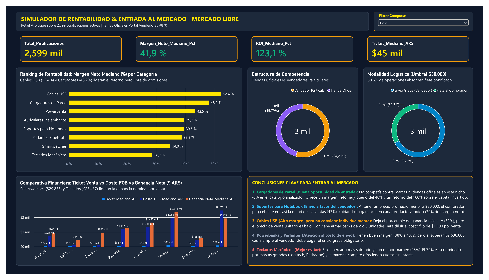

# Simulador de Rentabilidad y Estimación de Margen Operativo en Mercado Libre Argentina

Proyecto de portfolio enfocado en responder una pregunta comercial concreta: **si una persona quiere empezar a revender tecnología en Mercado Libre con poco capital, ¿en qué categoría le conviene entrar y en cuál no?**

En e-commerce muchas veces se mira solo el precio de venta y se asume un margen fijo. En la práctica, entre la comisión de la plataforma, el cargo fijo por unidad, los envíos obligatorios y el costo de reposición, un producto que parece rentable en los papeles puede terminar dando pérdida.

---

## De dónde salieron los datos y cómo los procesé

En lugar de usar un dataset genérico de internet, decidí recolectar datos reales de Mercado Libre sobre 8 categorías de tecnología:
* Cargadores de pared
* Cables USB
* Soportes para notebook
* Auriculares inalámbricos
* Smartwatches
* Parlantes Bluetooth
* Powerbanks
* Teclados mecánicos

### Extracción e ingesta (`01_extraer_datos_simulador.py`)
Descargué las publicaciones con una extensión de scraping en el navegador, obteniendo 8 archivos CSV (uno por cada categoría, guardados en `data/raw/`) con 3.675 publicaciones en bruto.

Con Python unifiqué los archivos leyendo las etiquetas del sitio (`andes-money-amount__fraction` para el precio de lista y `fraction 2` para ofertas) para consolidar todo en una base cruda y auditar filas incompletas o sin precio.

### Limpieza y calidad de datos con Pandas (`02_limpieza.py`)
Los datos crudos tenían varios errores típicos de scraping que corregí en esta etapa:
* **Escala de precios rota:** Por diferencias de formato en separadores de miles y decimales, algunos precios quedaban desfasados (por ejemplo, un producto de $68.000 figuraba como 68). Creé una función para detectar esos valores, corroborar la escala con la publicación original y multiplicarlos por 1.000 para recuperar el valor real en pesos.
* **Deduplicación:** Al raspar varias páginas de resultados se repetían publicaciones. Dedupliqué por título y categoría, quedando una muestra final de **2.599 publicaciones únicas**.
* **Clasificación de vendedores:** Identifiqué publicaciones con marca o vendedor informado frente a aquellas sin denominación visible ("Vendedor Particular") para evaluar la presencia de jugadores consolidados en cada nicho.

---

## El modelo de costos: reglas y supuestos de simulación (`03_modelo_financiero.py`)

Para estimar el margen unitario me basé en la estructura tarifaria de referencia del portal oficial de vendedores de Mercado Libre Argentina (guía de costos #870):

* **Comisión por venta:** 14,5% para publicaciones Clásicas y 29,5% para publicaciones Premium (aquellas que ofrecen cuotas sin interés).
* **Costo fijo:** Cargo fijo de $1.100 por cada unidad vendida cuyo precio sea menor al umbral de $30.000.
* **Envío gratis obligatorio:** En productos a partir de $30.000, la plataforma exige al vendedor ofrecer envío gratis. El vendedor absorbe una tarifa bonificada ($3.800 para accesorios chicos y $4.800 para productos de mayor peso o volumen como teclados o parlantes).
* **Costo de compra estimado:** Estimé una relación de costo mayorista / FOB de referencia por categoría (entre el 25% y 38% del PVP).

Con estos parámetros calculé la **ganancia estimada en pesos**, el **margen operativo estimado (%)** y el **retorno sobre la inversión estimada (ROI %)** para cada una de las 2.599 publicaciones.

### Supuestos del modelo y limitaciones analíticas
Para evaluar los resultados con rigor profesional, es importante distinguir qué incluye esta simulación y qué queda fuera:
* **Costos incluidos:** Comisión de plataforma según tipo de publicación, cargo fijo unitario en tickets bajos, flete bonificado a cargo del vendedor en publicaciones mayores a $30.000 y costo de adquisición mayorista estimado.
* **Costos no incluidos en el modelo:** No contempla la situación tributaria particular de cada vendedor (IVA, Ingresos Brutos, percepciones fiscales), inversión publicitaria (Mercado Ads), embalaje ni costos de logística inversa (devoluciones o mermas).
* **Propósito de la herramienta:** Funciona como un **filtro exploratorio de viabilidad comercial** para identificar qué categorías cuentan con un margen operativo lo suficientemente holgado como para absorber costos operativos e impositivos antes de invertir capital.

---

## Visualización en Power BI

Armé el dashboard interactivo en Power BI (`dashboard.pbix`) para facilitar la lectura de los datos.

### Criterios aplicados en el reporte:
* **Uso de medianas en vez de promedios:** En todas las medidas DAX principales usé la mediana. En marketplaces suele haber publicaciones con precios atípicos o combos gigantescos que inflan el promedio y distorsionan el mercado. La mediana refleja la venta típica.
* **Comparativa financiera unitaria:** El gráfico agrupa el precio de venta, el costo estimado de compra y el margen operativo estimado por cada unidad vendida.
* **Filtro interactivo:** Selector de categoría para analizar el comportamiento individual de cada nicho.

---

## Conclusiones y recomendaciones comerciales

Al cruzar margen estimado, presencia de marcas informadas y costos de envío, encontré 5 conclusiones claras:

1. **Cargadores de pared (Mejor oportunidad de entrada):** Es el nicho más conveniente para empezar con poco capital. Presenta un margen estimado mediano del 48% y un ROI del 160%, sin presencia masiva de marcas oficiales en la muestra analizada.
2. **Soportes para notebook (Ventaja en logística):** Al estar mayoritariamente por debajo de los $30.000, el comprador asume el envío en buena parte de las publicaciones. Esto evita que el vendedor absorba el flete, manteniendo un margen mediano del 39%.
3. **Cables USB (Margen alto pero ticket bajo):** Tienen el porcentaje de margen estimado más alto (52%), pero como el ticket mediano ronda los $15.000, el cargo fijo de $1.100 impacta fuerte en ventas unitarias. La recomendación comercial es armar packs de 2 o 3 unidades para diluir el costo fijo.
4. **Powerbanks y Parlantes (Atención al flete obligatorio):** Dejan márgenes de entre 38% y 43%, pero al superar casi siempre los $30.000 obligan al vendedor a financiar el envío gratis, restando ganancia en mano.
5. **Teclados mecánicos (Categoría a evitar):** Es el segmento más complejo para un particular. Presenta el margen estimado más bajo (28%), alta presencia de marcas establecidas (Logitech, Redragon) y la mayoría compite ofreciendo cuotas sin interés, lo que obliga a asumir la comisión más alta del 29,5%.

---

## Estructura del repositorio

* `data/raw/`: Archivos CSV originales obtenidos de la recolección por categoría.
* `scripts/`: Tubería de datos modular en Python:
  * `01_extraer_datos_simulador.py`: Ingesta, validación y consolidación de archivos crudos.
  * `02_limpieza.py`: Limpieza de formatos, deduplicación y corrección de escalas.
  * `03_modelo_financiero.py`: Motor de simulación financiera y cálculo de márgenes.
* `simulador_meli_dataset_final.csv`: Dataset final limpio y modelado con 2.599 publicaciones únicas.
* `dashboard.pbix`: Archivo de Power BI Desktop con el modelo de datos, medidas DAX y visualizaciones.
* `dashboard_simulador.png`: Captura de pantalla en alta resolución del reporte.
