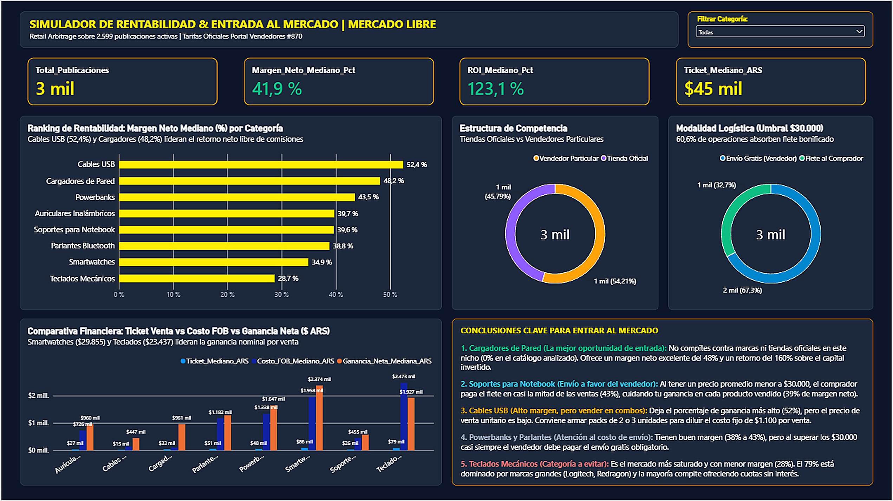

# Caso de Estudio: Simulador de Rentabilidad & E-Commerce Arbitrage en Mercado Libre Argentina

> **Perfil:** Data Analytics Junior / Business Intelligence  
> **Herramientas:** Python (Pandas, numpy), Power BI (PBIP, PBIR, TMDL, DAX), Web Scraping (Browser Tool / Ingesta de Datos), Git  
> **Dataset:** Recolección propia vía Web Scraping por lotes (+2.500 publicaciones vivas)  
> **Reglas de Negocio:** Tarifas Oficiales Portal de Vendedores Mercado Libre (#870)

---

## 1. El Problema de Negocio (Por qué no usé un dataset de Kaggle)

Cuando armé este proyecto para mi portfolio, no quería caer en el clásico dataset del Titanic o de ventas ficticias de bicicletas. Quería resolver una **pregunta de negocio real, con datos reales y desordenados** del mercado argentino:

> *"Si una persona quiere empezar a emprender revendiendo tecnología en Mercado Libre Argentina con un capital limitado (Retail Arbitrage), ¿en qué categoría le conviene meterse, en cuál NO y por qué?"*

Para responder esto no alcanzaba con saber a cuánto se vende un producto: en el e-commerce argentino, si no calculás la comisión por tipo de publicación, el costo fijo por unidad, el flete obligatorio de Mercado Envíos y el costo de reposición mayorista, **podés creer que estás ganando dinero cuando en realidad estás perdiendo**.

---

## 2. Pipeline de Datos: De la Web al Modelo (Arquitectura Medallion)

El proyecto se estructuró en un flujo de datos de tres capas en Python:

```
[ Extracción Web por Lotes: 8 categorías (Archivos cat_1 a cat_8) ]
              ↓
  Capa Bronze: Ingesta y Parsing de selectores DOM (01_extraer_datos_simulador.py)
              ↓
  Capa Silver: Limpieza de duplicados y Calidad (02_limpieza.py)
              ↓
  Capa Gold: Modelo Financiero (Basado en el PORTAL OFICIAL VENDEDORES MERCADO LIBRE) (03_modelo_financiero.py)
              ↓
  Dashboard Power BI 
```

### Fase 1: Extracción Web e Ingesta Automatizada (`01_extraer_datos_simulador.py`)
* **Extracción por lotes:** Relevamiento de 8 categorías clave de accesorios tech (*Cargadores de pared, Cables USB, Soportes para notebook, Auriculares inalámbricos, Smartwatches, Parlantes Bluetooth, Powerbanks y Teclados mecánicos*) utilizando una herramienta de web scraping en navegador, generando las capturas crudas por categoría (`cat_1_soporte.csv` a `cat_8_cableUSB.csv`).
* **Ingesta y Parsing en Python:** Con el script `01_extraer_datos_simulador.py`, se automatizó la lectura e integración de los 8 archivos, interpretando las clases HTML del DOM de Mercado Libre (distinguiendo `andes-money-amount__fraction` para el precio de lista y `andes-money-amount__fraction 2` para ofertas con descuento), unificando más de 3.600 publicaciones crudas con auditoría de errores.

### Fase 2: Limpieza y Calidad de Datos (`02_limpieza.py`)
Los datos reales de scraping vienen sucios. Tuve que resolver varios desafíos típicos de ingeniería de datos:
* **Detección de errores de coma y escala en precios:** Al parsear textos con separadores de miles, algunos precios quedaban truncados (ej. un producto de `$68.000` se leía como `68`). Creé una función de normalización que corrigió la escala automáticamente:
  ```python
  def normalizar_escala_precio(p):
      if pd.isna(p) or p <= 0:
          return np.nan
      p_int = int(p)
      if p_int < 1000:
          return p_int * 1000  # Corrige ej: 68 -> 68.000 ARS
      return p_int
  ```
* **Deduplicación estricta:** Al recorrer varias páginas de búsqueda, muchas publicaciones se repetían. Se deduplicó por `Categoria` y `Titulo`, descartando duplicados y consolidando **2.599 publicaciones únicas**.
* **Clasificación de Vendedores:** Mercado Libre no siempre entrega una etiqueta limpia de "Tienda Oficial". Creé la bandera lógica `EsTiendaOficial` (1 vs 0) aislando vendedores particulares de cuentas corporativas verificadas.

### Fase 3: Modelo Financiero con Reglas Reales (`03_modelo_financiero.py`)
En lugar de poner un margen fijo, implementé las **Tarifas Oficiales del Portal de Vendedores de Mercado Libre Argentina (Ficha Técnica #870)**:
1. **Comisión por Venta:**
   * **14,5%** en publicación *Clásica* (sin cuotas).
   * **29,5%** en publicación *Premium* (cuando ofrece Cuotas sin Interés).
2. **Costo Fijo Unitario:**
   * Mercado Libre cobra un cargo fijo extra de **$1.100 ARS** por cada unidad vendida cuyo precio sea **menor a $30.000 ARS**.
3. **Cofinanciación de Envíos:**
   * Si el precio es **>= $30.000 ARS**, el vendedor está obligado por plataforma a ofrecer **Envío Gratis**, asumiendo un costo bonificado de flete ($3.800 a $4.800 según peso/volumen).
4. **Costo Estimado de Compra (FOB / Mayorista):**
   * Calibrado por categoría entre el 25% y 38% del precio de venta final.
5. **Cálculo de Rentabilidad:**
   * **Ganancia Neta** = Precio Venta - Comisión MeLi - Costo Envío - Costo FOB
   * **Margen Neto %** = (Ganancia Neta / Precio Venta) * 100
   * **ROI %** = (Ganancia Neta / Costo FOB) * 100

---

## 3. El Dashboard en Power BI: Decisiones de Diseño y DAX


*Vista general del tablero interactivo en Power BI: KPIs ejecutivos, ranking de márgenes, estructura de competencia y logística, comparativa financiera unitaria y panel de conclusiones estratégicas.*

El tablero se construyó en **Power BI Desktop (`dashboard.pbix`)**, pensado con un diseño corporativo oscuro (`#0F172A`) de alto contraste:

### Medidas DAX Principales
Para evitar que publicaciones con precios extremos o promociones atípicas sesguen los datos, **usé la Mediana en lugar del Promedio**:

```dax
Ticket_Mediano_ARS = MEDIAN(simulador_meli_dataset_final[PrecioVentaARS])

Margen_Neto_Mediano_Pct = MEDIAN(simulador_meli_dataset_final[MargenNetoPct]) / 1000

ROI_Mediano_Pct = MEDIAN(simulador_meli_dataset_final[ROIPct]) / 1000

Ganancia_Neta_Mediana_ARS = MEDIAN(simulador_meli_dataset_final[GananciaNetaARS])

Costo_FOB_Mediano_ARS = MEDIAN(simulador_meli_dataset_final[CostoEstimadoCompra_FOB])
```

### Optimización Visual (Data Viz)
* **Etiquetas de datos en Miles:** En la Comparativa Financiera, un producto accesible como *Cables USB* ($15.000) comparte eje con un *Smartwatch* ($86.500). Para que las barras más chicas no se perdieran visualmente, configuré etiquetas de datos estandarizadas en miles (`$15 mil`, `$4 mil`, `$8 mil`), logrando una lectura inmediata sin forzar la vista sobre el eje Y.
* **Filtro interactivo (Slicer):** Selector por categoría en el encabezado que recalcula automáticamente todos los KPIs y gráficos al seleccionar un producto específico.

---

## 4. Conclusiones de Negocio: Las 5 Respuestas Clave

Del análisis surgieron **5 hallazgos comerciales concretos** que responden la pregunta inicial:

| # | Categoría | Margen Neto | ROI Mediano | Diagnóstico Comercial |
|---|---|---:|---:|---|
| **1** | **Cargadores de Pared** | **48,2 %** | **160,7 %** | **La mejor oportunidad de entrada.** Cero competencia de tiendas oficiales (0% en la muestra). Margen y ROI excelentes. |
| **2** | **Soportes para Notebook** | **39,6 %** | **113,1 %** | **El aliado logístico.** Al costar menos de $30.000, el comprador paga el flete en el 43% de las ventas, un gasto menos para el vendedor. |
| **3** | **Cables USB** | **52,4 %** | **209,6 %** | **Alto margen pero con trampa.** Deja el 52% de margen, pero como el ticket es de $15.000, el costo fijo de $1.100 por venta golpea fuerte. *Recomendación:* Vender en packs de 2 o 3 unidades para diluir el costo fijo. |
| **4** | **Powerbanks y Parlantes** | **38,8% - 43,5%** | **107% - 128%** | **Atención al flete.** Como analizamos en el caso de los Sopotes para Notebook, en este caso superan el umbral de $30.000, por lo que casi siempre obligan al vendedor a pagar el envío gratis bonificado de Mercado Envíos. |
| **5** | **Teclados Mecánicos** | **28,7 %** | **75,5 %** | **Nicho a evitar para principiantes.** El más saturado (79% tiendas oficiales como Redragon o Logitech). Menor margen y fuerte presión por absorber cuotas sin interés (comisión del 29,5%). |

---


